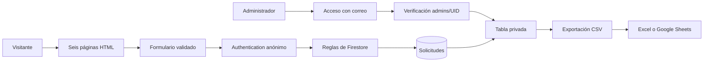

# Informe técnico — Harmony Heights

## 1. Propuesta y requisitos

Harmony Heights es una academia ficticia de música y artes escénicas. El sitio resuelve la presentación dispersa de programas y el registro manual de interesados mediante seis páginas públicas: Inicio, Nosotros, Programas, Música, Danza y Contacto. El dominio propuesto es `harmonyheights.edu.pe`.

Los PDF del trabajo final solicitan navegación responsive, HTML semántico, CSS interno y externo, Flexbox/Grid, Bootstrap, manipulación del DOM, formulario validado, explicación de GET/POST, informe y exposición. El panel privado de registros amplía esa base sin sustituir las seis páginas.

## 2. Tecnologías y organización

| Tecnología | Aplicación |
| --- | --- |
| HTML5 | Header, nav, main, section, article, aside y footer; etiquetas y campos asociados. |
| CSS3 | Colores, tipografía, espaciado, estados, transiciones y media queries. |
| Flexbox | Navegación, botones, filtros, pie y herramientas del panel. |
| Grid | Metodología, pasos y distribución del formulario/contacto. |
| Bootstrap 5.3 | Menú responsive, grillas, tarjetas, formulario, tabla y acordeón. |
| JavaScript | Eventos, condicionales, funciones, filtros y actualización del DOM. |
| Firebase Authentication | Sesiones anónimas para enviar y correo/contraseña para administrar. |
| Cloud Firestore | Persistencia de solicitudes y control de acceso mediante reglas. |
| PHP | Alternativa de POST con validación del lado servidor. |
| OpenStreetMap | Mapa referencial de Lima. |

La hoja externa `css/styles.css` reúne los estilos compartidos. Inicio conserva una regla interna para `.home-highlight`, cumpliendo el requisito de ambos tipos de CSS.

Los scripts se dividen por responsabilidad: `script.js` contiene interacciones generales; `accesibilidad.js`, preferencias y audio; `formulario.js`, validación y envío; `firebase.js`, conexión; `firebase-config.js`, configuración; y `registros.js`, acceso y tabla. Los nombres y funciones sustituyen los comentarios del código. El panel de accesibilidad está escrito en HTML y el audio utiliza un reproductor, evitando crear interfaces o sintetizar sonido desde JavaScript.

## 3. Arquitectura

La configuración pública no concede permiso para leer los datos. Las reglas de `firestore.rules` validan cada documento y limitan su lectura a usuarios con un documento `admins/UID`. Los clientes no pueden crear esos permisos, modificar registros ni eliminarlos. Los permisos administrativos se crean desde la consola del propietario.

## 4. UX/UI y accesibilidad

La paleta conserva azul, papel, coral y verde, con coral más oscuro para que los botones sean legibles. Las secciones alternan superficies claras, verdes y oscuras. Las tarjetas tienen fondo opaco; los campos y controles cuentan con bordes más definidos.

El modo de alto contraste cubre navegación, hero, tarjetas, etiquetas, tablas, acordeones, campos, estados, pie y herramientas. Se ofrecen tamaño de texto, fuente legible, escala de grises, enlaces destacados y reducción de movimiento. El audio es opcional y no comienza automáticamente.

Se incluyen enlace para saltar al contenido, foco visible, textos alternativos, mensajes con aria-live y controles identificados. El contenido permanece visible sin JavaScript. Las preferencias de movimiento del sistema se respetan y las animaciones principales son transiciones CSS sencillas.

## 5. Formulario y almacenamiento

Se solicitan nombre, correo, teléfono, edad, programa, horario, objetivo opcional y consentimiento. HTML valida obligatoriedad, longitudes, tipos, patrón y rangos. JavaScript elimina espacios al inicio y al final y envía solo los campos previstos. Las reglas de Firestore repiten la validación de datos y exigen que el UID coincida con el usuario y la fecha provenga del servidor.

El botón se desactiva durante el envío. Solo una respuesta confirmada produce el mensaje de éxito y limpia los campos. Si falla, conserva los datos y explica el problema. No hay respaldo de datos personales en localStorage ni cambio automático de proveedor.

GET se demuestra al navegar a `contacto.html?programa=musica`: lleva una preferencia no sensible. El SDK de Firestore gestiona sus solicitudes de red para el guardado. Para mostrar explícitamente POST JSON, se conserva `backend/registro.php`, activable con `storageMode = "php"`. Este backend es independiente de Firebase y el panel no consulta sus archivos.

## 6. Administración y hojas de cálculo

`registros.html` utiliza correo y contraseña y verifica el permiso del UID. Carga las 500 solicitudes más recientes, permite búsqueda por nombre/correo y filtro por programa y exporta las filas visibles con todos sus campos a CSV UTF-8. La fecha se muestra en la zona America/Lima. El CSV neutraliza textos que podrían ejecutarse como fórmulas en una hoja de cálculo.

La exportación permite trabajar en Excel y Google Sheets mediante importación. No existe sincronización automática con Google Sheets. Los registros se insertan en la tabla mediante textContent para que el contenido recibido no se interprete como HTML.

## 7. Respuestas a las preguntas guía

1. **Estructura institucional:** seis páginas, menú consistente y recorrido de descubrir programas a solicitar orientación.
2. **Diseño y maquetación:** tipografía jerárquica, espacios, paleta coherente, tarjetas, CTA y distribución adaptable con Grid, Flexbox y Bootstrap.
3. **JavaScript útil:** filtros, selección de programa, accesibilidad, validación y consulta de solicitudes con funciones de responsabilidad concreta.
4. **Datos y validación:** información mínima de contacto y preferencias; validación en navegador y reglas del servicio antes de guardar.
5. **Integración coherente:** HTML estructura, CSS presenta, Bootstrap ayuda con componentes y JavaScript conecta la interacción con la persistencia.

## 8. Activación y límites

Consulta `FIREBASE.md`. El propietario debe crear Firestore, habilitar Authentication, publicar las reglas y autorizar su UID. La configuración está incorporada, pero no demuestra por sí sola que esos servicios estén activos.

Antes de uso público se deben configurar App Check, cuotas, alertas, privacidad y conservación de datos. Las reglas y sesiones anónimas no sustituyen una protección contra spam. El servidor PHP de desarrollo se utiliza solo con datos ficticios y no aplica las restricciones de Apache.

La publicación, los nombres de los integrantes y las diapositivas finales deben completarse según la entrega académica. No se afirma un despliegue nuevo como parte de esta revisión local.
