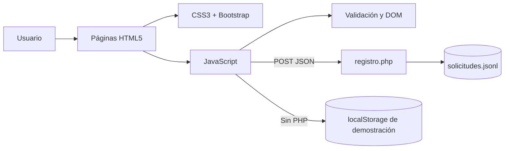
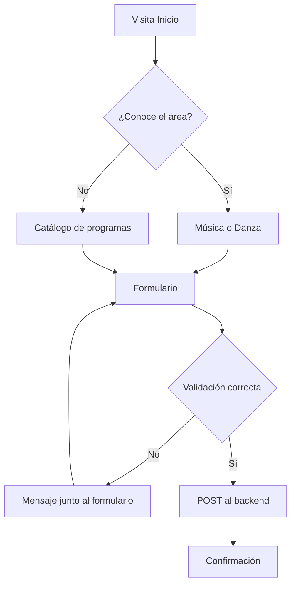

# Informe técnico — Harmony Heights

## 1. Datos generales

- **Proyecto:** Harmony Heights
- **Tipo:** Sitio web institucional responsive de varias páginas
- **Sector:** Educación artística
- **Dominio propuesto:** `harmonyheights.edu.pe`
- **Objetivo:** Presentar servicios académicos y captar solicitudes de orientación de forma clara, ordenada y profesional.

> Harmony Heights es una institución ficticia desarrollada con fines académicos. Los programas, horarios y datos de contacto mostrados son demostrativos.

## 2. Problema y solución

Una institución con información dispersa y registro manual puede perder interesados y proyectar una imagen poco profesional. La propuesta centraliza la oferta académica, facilita la navegación desde celular o computadora y crea un flujo de registro con validaciones.

La solución incluye seis páginas:

1. **Inicio:** propuesta principal, programas destacados, metodología y llamada a la acción.
2. **Nosotros:** propósito, enfoque y valores institucionales.
3. **Programas:** catálogo general con filtros dinámicos.
4. **Música:** categoría con programas, metodología y horarios referenciales.
5. **Danza:** categoría con programas y preguntas frecuentes.
6. **Contacto:** formulario de orientación conectado a un backend básico.

## 3. Arquitectura



### Organización de archivos

```text
docs/
├── index.html
├── nosotros.html
├── programas.html
├── musica.html
├── danza.html
├── contacto.html
├── css/
│   └── styles.css
├── js/
│   └── script.js
├── backend/
│   ├── registro.php
│   ├── README.md
│   └── data/
│       ├── .gitignore
│       └── .htaccess
├── INFORME_TECNICO.md
└── GUIA_EXPOSICION.md
```

## 4. Tecnologías empleadas

| Tecnología | Aplicación en el proyecto |
|---|---|
| HTML5 | Estructura semántica con `header`, `nav`, `main`, `section`, `article`, `aside` y `footer`. |
| CSS3 | Paleta, tipografía, espaciado, estados, animaciones y adaptación responsive. |
| Flexbox | Navegación, grupos de botones, filtros, pies de página y alineaciones. |
| CSS Grid | Metodología, pasos y bloques de características. |
| Bootstrap 5.3 | Menú colapsable, grilla responsive, botones, formulario, tabla y acordeón. |
| JavaScript | Filtros, navegación activa, animaciones, año automático, DOM y envío asíncrono. |
| PHP | Endpoint `POST`, validación del lado servidor y persistencia mínima. |
| JSON Lines | Un objeto JSON por solicitud, fácil de revisar en una demostración. |
| OpenStreetMap | Mapa referencial embebido sin necesidad de una clave privada. |
| Web Audio API | Generación de una melodía ambiental opcional sin archivo con copyright. |

### CSS interno y externo

La hoja externa `css/styles.css` concentra el sistema visual reutilizado por todas las páginas. En `index.html` se incluye una regla interna pequeña para `.home-highlight`, como demostración académica de CSS interno. Se limita a un detalle único para evitar duplicación y conservar la mantenibilidad.

## 5. UX/UI y accesibilidad

- Menú consistente y responsive en todas las páginas.
- Jerarquía visual con títulos, subtítulos, espacios y contrastes claros.
- Botones CTA visibles hacia programas y contacto.
- Enlace “Saltar al contenido” para navegación por teclado.
- Textos alternativos en imágenes y etiquetas conectadas a cada campo.
- Mensajes del formulario anunciados mediante `aria-live`.
- Compatibilidad con `prefers-reduced-motion` para reducir animaciones.
- Panel de accesibilidad con aumento de texto, alto contraste, escala de grises, fuente legible, enlaces resaltados y reducción de movimiento.
- Preferencias persistentes mediante `localStorage` y controles con estados `aria-pressed`.
- Botón flotante “Volver arriba” disponible después de desplazarse.
- Diseño adaptable mediante `clamp()`, Bootstrap y *media queries*.
- El contenido demostrativo se identifica como tal y no inventa cifras o testimonios.

## 6. Interactividad con JavaScript

El archivo externo `js/script.js` utiliza:

- Variables y constantes (`const`, `let`).
- Funciones separadas por responsabilidad.
- Condicionales y operadores.
- Eventos `DOMContentLoaded`, `click` y `submit`.
- Manipulación del DOM mediante clases, atributos, texto y la propiedad `hidden`.
- `IntersectionObserver` para revelar elementos al entrar en pantalla.
- `URLSearchParams` para seleccionar un programa desde la URL.
- `fetch()` con `async/await` para enviar el formulario mediante `POST`.
- `localStorage` como respaldo explícitamente demostrativo cuando PHP no está activo.
- Creación compartida del panel de accesibilidad, el botón de retorno y el control de ambiente.
- Web Audio API para generar notas suaves sin reproducir contenido automáticamente.

## 7. Formulario y backend

### Datos solicitados

Nombre, correo, teléfono, edad, programa, horario, objetivo opcional y consentimiento. Son suficientes para orientar al interesado sin pedir información innecesaria.

### Validación

El navegador valida obligatoriedad, tipo, longitud, patrón y rangos. El servidor repite la validación porque cualquier persona puede omitir o alterar el JavaScript.

### GET y POST

- **GET** se usa implícitamente para solicitar páginas y para llevar una preferencia no sensible en la URL, por ejemplo `contacto.html?programa=musica`.
- **POST** se usa para enviar el formulario, porque los datos viajan en el cuerpo de la solicitud y no quedan expuestos en la URL.

El backend crea `backend/data/solicitudes.jsonl`. En un producto real, se reemplazaría por una base de datos y se agregarían HTTPS, CSRF, autenticación administrativa, rate limiting y política de privacidad.

## 8. Flujo del usuario



## 9. Respuestas a las preguntas guía

### 1. ¿Cómo estructurar la página?

Con navegación constante, inicio que resume la propuesta, páginas específicas para institución y categorías, catálogo general y contacto. Las etiquetas semánticas describen cada bloque y mejoran accesibilidad y mantenimiento.

### 2. ¿Qué diseño mejora la usabilidad?

Una paleta limitada, contraste suficiente, tipografía legible, espacios amplios, tarjetas con información comparable y botones consistentes. Grid y Flexbox mantienen el orden, mientras Bootstrap adapta la estructura a diferentes pantallas.

### 3. ¿Cómo aporta JavaScript sin afectar la claridad?

Solo en tareas útiles: filtrar programas, señalar la página actual, mostrar estados del formulario, preseleccionar intereses y aplicar animaciones discretas. Si JavaScript falla, el contenido principal sigue disponible.

### 4. ¿Qué debe pedir y cómo validarlo?

Solo datos necesarios para la orientación. Cada campo se valida primero en HTML/JavaScript para una respuesta rápida y nuevamente en PHP para mantener la integridad de la información.

### 5. ¿Cómo se demuestra la integración?

La semántica está en los seis HTML; el sistema visual y responsive en CSS; los componentes y grillas en Bootstrap; los eventos y DOM en JavaScript; la captación en el formulario; y el procesamiento real en PHP.

## 10. Ejecución y publicación

### Vista estática

Abrir `index.html` o publicar la carpeta `docs` con GitHub Pages. En esta modalidad el sitio funciona, pero el formulario entra en modo demostración porque GitHub Pages no ejecuta PHP.

### Vista completa con backend

Con PHP 8 instalado, ejecutar dentro de `docs`:

```bash
php -S localhost:8000
```

Abrir `http://localhost:8000`. Para producción con backend se requiere un hosting compatible con PHP.

## 11. Conclusión

La propuesta resuelve el caso mediante una arquitectura pequeña y comprensible. Separa contenido, presentación, comportamiento y procesamiento; cumple los recursos técnicos solicitados; y deja una ruta clara para evolucionar hacia una base de datos sin complicar la entrega académica actual.

## 12. Evidencias de maquetación

### Inicio en escritorio


### Contacto en ancho reducido


