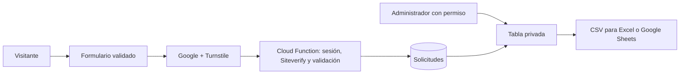

# Informe técnico — Harmony Heights

## Propuesta

Academia ficticia de música y artes escénicas. El sitio centraliza los programas y organiza el registro de interesados. Mantiene las seis páginas pedidas: Inicio, Nosotros, Programas, Música, Danza y Contacto. El panel privado amplía esa estructura. El dominio académico propuesto es `harmonyheights.edu.pe`; la publicación utiliza GitHub Pages.

## Tecnologías y requisitos

| Requisito | Aplicación |
| --- | --- |
| HTML5 semántico | Header, nav, main, section, article, aside y footer. |
| CSS interno y externo | Estilo puntual de `.home-highlight` en Inicio y hojas compartidas. |
| Flexbox y Grid | Navegación, filtros, metodología, pasos y contacto. |
| Bootstrap | Menú móvil, grillas, botones, tabla, formulario y acordeón. |
| JavaScript y DOM | Filtros, selección desde URL, validación, accesibilidad y música. |
| Registro funcional | Authentication con Google y Turnstile verificado en servidor y guardado en Cloud Firestore. |
| Administración | Google o correo/contraseña, permiso por UID, tabla y exportación CSV. |
| Responsive y accesibilidad | Contraste, teclado, etiquetas, mensajes aria-live y reducción de movimiento. |
| Exposición y evidencias | Presentación HTML con web incrustada y capturas en `evidencias`. |

Los scripts se dividen por responsabilidad y usan nombres de funciones para explicar su propósito. Los controles están escritos en HTML.

## Flujo de datos

El formulario solicita nombre, correo, teléfono, edad, programa, día, horario, objetivo opcional y consentimiento. HTML valida tipos, longitudes y rangos. JavaScript recorta espacios y envía solo los campos previstos. La función vuelve a validar los datos y añade el UID autenticado y la fecha del servidor. Las reglas prohíben escrituras directas del cliente.

El botón se desactiva durante el envío. Solo el guardado confirmado limpia el formulario. Si falla, los campos permanecen disponibles para reintentar. No se guardan datos personales en el almacenamiento local del navegador.

Los visitantes pueden enviar solicitudes válidas mediante la función y no pueden leerlas. Solo usuarios con un documento `admins/UID` pueden consultar registros. El navegador no puede crear administradores ni modificar o eliminar solicitudes. El panel carga las 500 más recientes y exporta las filas filtradas; muestra texto recibido con textContent y neutraliza fórmulas en CSV.

GET se utiliza para obtener páginas y llevar preferencias como `?programa=musica`. El SDK de Firebase gestiona las solicitudes de red para autenticar y guardar. GitHub Pages sirve el frontend estático; el endpoint callable HTTPS reside en Firebase Cloud Functions.

## Diseño, música y presentación

La paleta combina azul, papel, coral oscuro y verde. El alto contraste cubre navegación, tarjetas, tablas, acordeón, formulario, pie y reproductor. Se incluyen foco visible, salto al contenido, textos alternativos y controles etiquetados.

Las cuatro pistas MP3 se reproducen desde un panel flotante con título y artista o autor de la obra, pausa, pista anterior/siguiente y volumen inicial del 12 %. Si el navegador bloquea el inicio automático, se espera una interacción. La sesión conserva pista, posición, volumen y pausa. La presentación comparte el reproductor y su web incrustada no inicia otra pista.

La diapositiva de demostración carga la web desde el mismo sitio al visitarla. Ofrece recarga y apertura en otra pestaña. Los atajos de diapositivas respetan botones y campos, por lo que no interfieren con el control de volumen.

## Preguntas guía

1. **Estructura:** seis páginas, menú constante y recorrido de programas a orientación.
2. **Diseño:** jerarquía tipográfica, espaciado, contraste, tarjetas y CTA con distribución adaptable.
3. **JavaScript útil:** filtros, accesibilidad, música y formularios con funciones separadas.
4. **Datos:** contacto y preferencias mínimos, validados en el navegador y en la función del servidor.
5. **Integración:** HTML estructura, CSS presenta, Bootstrap aporta componentes y JavaScript conecta interacción y datos.

## Publicación

GitHub Actions prepara los archivos al recibir un push a `main` y los despliega en Pages. La presentación se publica directamente desde `docs/presentacion.html`. La configuración de Firebase está en el frontend por diseño; los permisos dependen de Authentication y las reglas. La activación del proyecto y del administrador se explica en `FIREBASE.md`.

Antes de utilizar datos reales deben completarse privacidad, conservación, cuotas y protección contra abuso. Las reglas, Turnstile y el acceso con Google no equivalen a un límite de envíos. Las verificaciones locales no sustituyen una prueba contra la configuración real de Firebase.

## Verificación de Cloudflare en el servidor

El formulario envía los datos y un token Turnstile a la Cloud Function callable
`submitRegistration`. Firebase verifica la sesión de Google. La función valida
campos y horarios, consulta Siteverify con una clave secreta de Secret Manager
y exige `success`, el hostname autorizado y la acción `contacto`. Solo entonces
el Admin SDK guarda el registro con UID autenticado y fecha del servidor.
Las reglas bloquean la creación directa desde clientes, manteniendo la lectura
reservada a administradores. Un fallo de verificación no crea registros.
